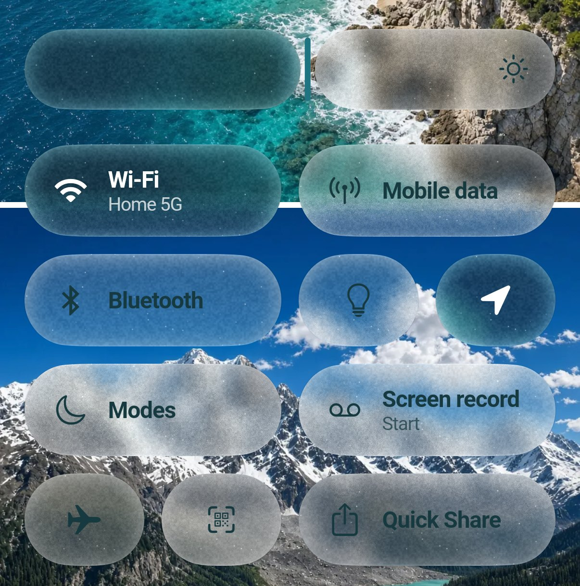
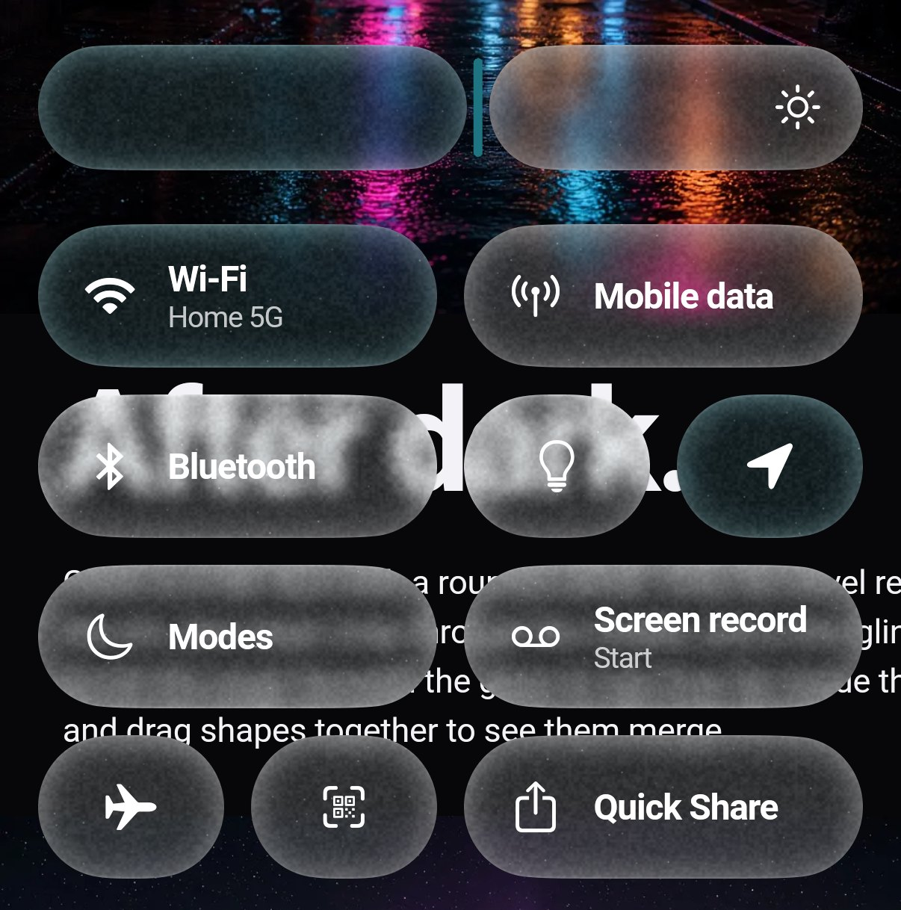
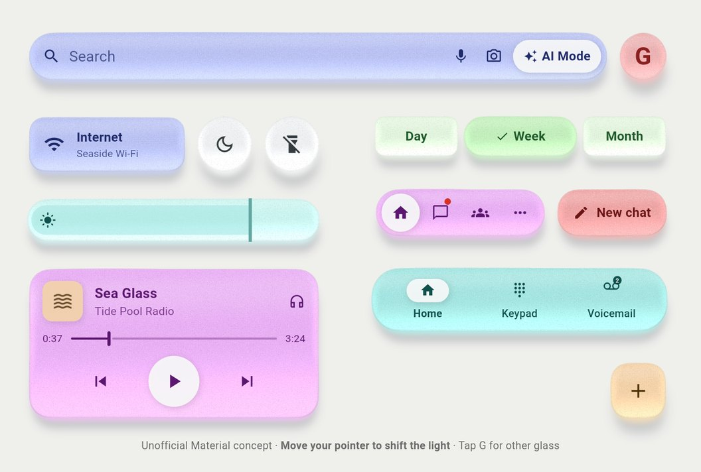
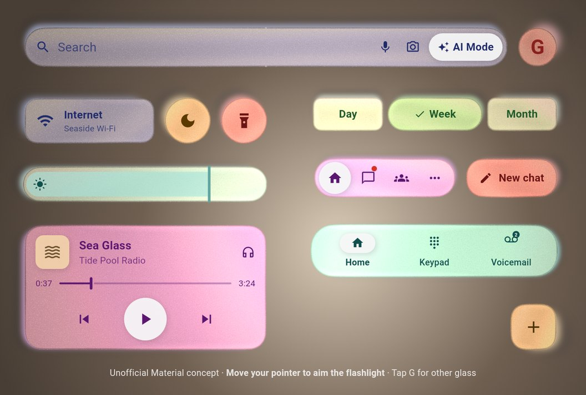

# Liquid Glass Renderer

[](https://pub.dev/packages/liquid_glass_renderer)
[](./test/)
[![lints by lintervention][lintervention_badge]][lintervention_link]

iOS 27-style Liquid Glass for Flutter: refraction through a rounded bevel,
frost, tint, a directional glint, a dark border, and shapes that melt into each
other. It is fitted against captures of Apple's own glass, and it ships presets
for the regular, toolbar and clear materials, including the Settings Liquid
Glass slider.

It reproduces the look with Flutter's own rendering; it does not use Apple's
private material APIs.

| Light | Dark |
| --- | --- |
|  |  |
|  |  |

> **1.0 prerelease: the renderer was rewritten.**
>
> `1.0.0-dev` replaces the whole API of `0.2.x`. There are no deprecations;
> see the [changelog](CHANGELOG.md) for what moved where. Full glass needs
> Impeller and the Flutter GPU API, which is still in preview. APIs and
> rendering may change before 1.0. Profile your real screens on physical
> devices before shipping.

## Contents

- [Requirements](#requirements)
- [Quick start](#quick-start)
- [The widgets](#the-widgets)
- [Blending shapes](#blending-shapes)
- [iOS 27 presets and the Liquid Glass slider](#ios-27-presets-and-the-liquid-glass-slider)
- [Tint and color](#tint-and-color)
- [Sea glass](#sea-glass)
- [Refraction](#refraction)
- [Glint](#glint)
- [Visibility](#visibility)
- [FakeGlass](#fakeglass)
- [Glass on glass and `LiquidGlassCapture`](#glass-on-glass-and-liquidglasscapture)
- [Performance](#performance)
- [Example playground](#example-playground)

## Requirements

- Flutter 3.47 or newer.
- Impeller and Flutter GPU for full glass. Pass `--enable-flutter-gpu` to
  `flutter run`, or turn it on in the app: `FLTEnableFlutterGPU` in
  `Info.plist` (iOS, macOS) and the
  `io.flutter.embedding.android.EnableFlutterGPU` meta-data in
  `AndroidManifest.xml`. The example app shows both.
- iOS, Android and macOS are the platforms the renderer is tested on. Web
  builds compile and render [FakeGlass](#fakeglass).

Wherever full glass is unavailable, layers switch to `FakeGlass`
automatically.

```sh
flutter pub add liquid_glass_renderer
```

## Quick start

Glass samples the pixels behind it, so put your content and the glass in a
`Stack`:

```dart
import 'package:flutter/widgets.dart';
import 'package:liquid_glass_renderer/liquid_glass_renderer.dart';

class GlassPill extends StatelessWidget {
  const GlassPill({super.key});

  @override
  Widget build(BuildContext context) {
    final brightness = MediaQuery.platformBrightnessOf(context);
    return Stack(
      children: [
        const Positioned.fill(child: MyContent()),
        Center(
          child: LiquidGlassLayer(
            settings: LiquidGlassSettings.ios27Toolbar(brightness: brightness),
            child: const LiquidGlass(
              shape: LiquidRoundedSuperellipse(borderRadius: 28),
              child: SizedBox(width: 220, height: 56),
            ),
          ),
        ),
      ],
    );
  }
}
```

Shaders and the GPU pipeline load on first use, so the first glass on screen
paints `FakeGlass` for a frame or two. Warm them up before `runApp`:

```dart
Future<void> main() async {
  WidgetsFlutterBinding.ensureInitialized();
  await LiquidGlass.precache();
  runApp(const MyApp());
}
```

On Android the GPU part finishes after the first frame.

## The widgets

| Widget | What it does |
| --- | --- |
| `LiquidGlassLayer` | Samples the backdrop once and renders every glass shape below it. Owns the shared `LiquidGlassSettings`. |
| `LiquidGlass` | One glass shape. Its child paints on top of the glass, clipped to the shape. |
| `LiquidGlassBlendGroup` | Melts the `LiquidGlass.grouped` shapes inside it into one surface. |
| `LiquidGlassCapture` | Captures the backdrop once for glass that sits on other glass. |
| `LiquidGlassVisibility` | Fades the glass in a subtree in and out. |
| `FakeGlass` | The fallback without refraction, used automatically where full glass is unavailable. |
| `LiquidGlassSettings` | Refraction, frost, glint, border and inner shadow, shared by a layer. |
| `LiquidGlassAppearance` | Tint, color model and visibility, per shape or as a layer default. |

`LiquidGlass` has four constructors:

| Constructor | Use it when |
| --- | --- |
| `LiquidGlass(...)` | A `LiquidGlassLayer` is above it. |
| `LiquidGlass.grouped(...)` | It sits in a `LiquidGlassBlendGroup` and should blend with its neighbors. |
| `LiquidGlass.auto(...)` | Reusable code that may or may not have a layer above it. It uses a parent layer when there is one and creates its own otherwise. |
| `LiquidGlass.withOwnLayer(...)` | It needs its own backdrop sample or its own settings, for example glass on glass. |

Put sibling shapes in one layer. Every independent layer samples the backdrop
again, and that sample is the expensive part (see
[Performance](#performance)).

Shapes are `LiquidRoundedSuperellipse` (squircles and capsules), `LiquidOval`
and `LiquidRoundedRectangle`, each with one corner radius, and `LiquidBlob`,
an organic outline (see [Pebbles and living glass](#pebbles-and-living-glass)).
Exterior shadows go
on the shape, and the renderer cuts them out behind the translucent glass:

```dart
LiquidGlass(
  shape: const LiquidRoundedSuperellipse(borderRadius: 28),
  shadows: const [
    BoxShadow(color: Color(0x24000000), offset: Offset(0, 6), blurRadius: 20),
  ],
  child: const SizedBox(width: 220, height: 56),
)
```

`GlassGlow` adds a touch glow inside the glass, and `LiquidStretch` gives it
the squash and stretch of iOS controls while it is dragged.

## Blending shapes

| Light | Dark |
| --- | --- |
|  |  |

Shapes in a `LiquidGlassBlendGroup` join like drops of water once they come
within `blend` logical pixels of each other (default `20`). Straight edges that
touch stay straight; only the gap between them rounds, as in iOS 27's
`GlassEffectContainer`.

```dart
LiquidGlassLayer(
  child: LiquidGlassBlendGroup(
    blend: 24,
    child: Row(
      children: const [
        LiquidGlass.grouped(
          shape: LiquidOval(),
          child: SizedBox.square(dimension: 56),
        ),
        SizedBox(width: 8),
        LiquidGlass.grouped(
          shape: LiquidRoundedSuperellipse(borderRadius: 28),
          child: SizedBox(width: 180, height: 56),
        ),
      ],
    ),
  ),
)
```

A layer renders at most 16 shapes; in debug builds it warns when it has to
leave some out. Plain `LiquidGlass` shapes in the same layer don't blend.
`FakeGlass` blends a group too (see [FakeGlass](#fakeglass)).

Each shape joins only the members within two blend radii of the nearest one,
so the union doesn't depend on shapes far away. When a shape moves, the
layer copies its last geometry and redraws only around that shape: dragging
one tile of a 16-shape panel redraws about a fifth of the geometry. The result
is the same as redrawing all of it.

## iOS 27 presets and the Liquid Glass slider

Glass is configured in two parts. `LiquidGlassSettings` on the layer holds the
optics and lighting. `LiquidGlassAppearance` holds the color, either as the
layer's `defaultAppearance` or per shape.

| Material | Settings | Appearance |
| --- | --- | --- |
| Regular (`.regular`, `.glass` buttons) | `LiquidGlassSettings(frost: LiquidGlassSettings.ios27RegularFrost(t), tintAmount: t)` | `ios27Regular(brightness:)` |
| Toolbar | `ios27Toolbar(brightness:)` | `ios27Toolbar(brightness:)` |
| Clear (`.clear`) | `ios27Clear()` | `ios27Clear()` |

Light and dark variants exist as separate constructors too
(`ios27ToolbarLight`, `ios27ToolbarDark`, ...). A layer without a
`defaultAppearance` uses the toolbar appearance for the platform brightness.

```dart
final brightness = MediaQuery.platformBrightnessOf(context);

LiquidGlassLayer(
  settings: LiquidGlassSettings.ios27Toolbar(brightness: brightness),
  defaultAppearance: LiquidGlassAppearance.ios27Regular(brightness: brightness),
  child: const MyToolbar(),
)
```

`t` is the slider position described below. The presets are fitted to
Apple's glass at toolbar and button size. They are a
starting point: Apple also varies its glass with the control's role, size and
accessibility settings.

### `tintAmount`: the Liquid Glass slider

iOS 27 has a Liquid Glass slider in Settings, from Clear (`0`) to Tinted
(`1`). Pass its position as `tintAmount`. The renderer does not read the
system setting; your app decides.

```dart
LiquidGlassSettings.ios27Toolbar(brightness: brightness, tintAmount: 0.5)
```

The slider changes three things, each along a curve fitted to Apple's glass:

- **Wash.** The iOS 27 color model makes its neutral wash more opaque, and
  dark glass denser.
- **Border.** The dark border gets stronger.
- **Blur.** The presets derive `frost` from the slider.
  `LiquidGlassSettings.ios27RegularFrost(tintAmount)` gives 2, 6.1 and
  16.6 pt at 0, 0.5 and 1; `ios27ClearFrost(tintAmount)` gives 0.35, 1.28 and
  16.4 pt, growing at one rate up to the middle tick and at twice that rate
  beyond it. Pass `frost` to override.

The glint doesn't change. The direct color model ignores `tintAmount`, and
`tintAmount` never changes an explicit `frost`.

## Tint and color

| Light | Dark |
| --- | --- |
|  |  |

Tint a single shape through its appearance. Neighbors in a blend group
cross-fade their colors where they meet, from the same backdrop sample:

```dart
LiquidGlass.grouped(
  appearance: const LiquidGlassAppearance.ios27ToolbarLight(
    tint: Color(0xFF0A84FF),
  ),
  shape: const LiquidOval(),
  child: const SizedBox.square(dimension: 72),
)
```

The iOS 27 presets use `LiquidGlassColorModel.ios27`. It turns one tint color
and its opacity into tones that depend on the brightness of the backdrop,
like Apple's single-tint API. Dark regular glass also gets denser with size:
up to 75 pt on the short side it transmits like light glass, and from 105 pt
it settles at Apple's denser dark material. The smallest shape in a layer
decides. Clear glass (`LiquidGlassColorModel.ios27Clear`) is the same in light
and dark.

For full control, use the direct model and tune each transfer yourself:

```dart
const LiquidGlassAppearance(
  colorModel: LiquidGlassColorModel.direct(),
  tint: Color(0x663B82F6),
  saturation: 1.4,
  transmissionGamma: 0.9,
  vibrancy: 0.15,
)
```

A layer where every shape has the same appearance keeps a smaller shader path.

## Sea glass

| Light | Dark |
| --- | --- |
|  |  |

Sea glass is glass the sea has tumbled into a frosted pebble. It stays
translucent, but its surface is pitted into a fine sugary frost, its rounded
rim is paler than its body, and the glass itself is colored throughout, so it
is deepest in color where it is thickest. Compared to iOS 27 glass it is a
dome rather than a flat face with a bevel: the whole face bends the backdrop
like a lens, there is no inner shadow, and the light glints off its rounded
shoulders.

Start from the `seaGlass` preset and give each shape a body color:

```dart
LiquidGlassLayer(
  settings: LiquidGlassSettings.seaGlass(),
  defaultAppearance: LiquidGlassAppearance.seaGlass(
    color: SeaGlassColors.white.withValues(alpha: 0.55),
  ),
  child: Row(
    children: const [
      LiquidGlass(
        appearance: LiquidGlassAppearance.seaGlass(color: SeaGlassColors.teal),
        shape: LiquidRoundedSuperellipse(borderRadius: 32),
        child: SizedBox(width: 170, height: 64),
      ),
      SizedBox(width: 12),
      LiquidGlass(
        shape: LiquidRoundedSuperellipse(borderRadius: 32),
        child: SizedBox(width: 170, height: 64),
      ),
    ],
  ),
)
```

Under a sea glass finish the appearance tint is the body color, not a wash:
it filters the backdrop like colored glass. The color is what the glass shows
over white at full thickness, and its alpha is the density, so `0` is
colorless frosted glass. `SeaGlassColors` holds colors sampled from real sea
glass: `seafoam`, `kellyGreen`, `aqua`, `cornflower`, `cobalt`, `lavender`,
`citron`, `amber`, `brown` (root beer), `teal`, `white`, `ruby`, `clear` and
`mist`. Each shape can have its own, and merged shapes blend them.

The surface is a `SeaGlassFinish` on the layer's settings
(`LiquidGlassSettings.seaGlassFinish`), shared by every shape:

| Control | What it does |
| --- | --- |
| `strength` | Cross-fades from regular glass (`0`) to sea glass (`1`). |
| `depth` | How far in from the rim the pebble reaches full thickness, in logical pixels. |
| `scatter` | The share of light the frost scatters. Scattered light leaves the glass in its body color, so it glows even over dark content. |
| `rimGlow` | Brightness of the frosted rim, strongest on the side facing the light. |
| `grain`, `grainSize` | The fine sugary texture of the pits. |
| `sparkle` | Tiny glints where single pits catch the light. |
| `pitting` | How far the pits scatter the backdrop, in logical pixels, on top of `frost`. |
| `gloss` | How brightly the dome catches the light: a curved glint on the shoulder facing it, a softer one on the far wall, and a thin bright line along the outline. The flat center stays untouched. |
| `stochasticFrost` | Renders `frost` in the glass pass by scattering samples, instead of a blur pass (default `true`, see below). |

`SeaGlassFinish()` keeps the backdrop readable. `SeaGlassFinish.frosted()` is
a milkier pebble (pair it with a larger `frost`, around `10`) and
`SeaGlassFinish.clear()` a barely tumbled shard. `SeaGlassFinish.shadows`
returns a soft shadow tinted by the body, as colored glass casts on a light
surface; keep its `elevation` small for flat UI.

### How sea glass differs from clear glass

Apple's Liquid Glass is smooth, clear glass. Sea glass keeps its behavior
(one shared backdrop sample, lensing, materializing with light rather than
opacity, merging like droplets, a glow under the finger) but its physics
differ:

- **Refraction.** A pebble's face is curved all over, not flat with a bevel,
  so the `seaGlass` preset turns `refractionFitsShape` off and makes the
  lens a 100 pt dome: it is flat at the center and steepens toward the
  outline, so grid lines seen through a pebble bow outward toward its rim,
  as through a magnifying glass. Smaller pebbles bend proportionally less.
  The frost and the pits then smear what the lens bends. For a clear lens,
  use `SeaGlassFinish.clear()` with `frost: 0`, and a little `dispersion`
  (around `0.06`) for rainbow edges.
- **Thickness.** Larger glass behaves like thicker material: a large card
  absorbs more of its body color and scatters light more softly than a
  small button with the same finish.
- **Lighting.** A rough surface has no crisp highlight. Apple's glint is
  dimmed; instead the light glints off the dome's shoulder facing it
  (`gloss`), the frosted rim glows on that side, and the pits are tiny
  facets that glint when they face it.
- **Merging.** Shapes in a `LiquidGlassBlendGroup` fuse like droplets, as on
  iOS. Between two pebbles the bridge is thin glass, so it is paler and
  frostier than either body, and the two body colors blend across it. Each
  shape's frost lies on that shape's own surface: it moves, turns and
  stretches with the shape, and cross-fades without a seam across a
  bridge.
- **Interaction.** `LiquidStretch.seaGlass` behaves like a heavier drop than
  Apple's gel-like glass. It swells a little less when pressed and resists
  the drag more, but still stretches far enough to flow into a neighbor in a
  blend group, and it wobbles back when let go (`wobble`). In the example's
  quick settings, tiles pulled toward each other bridge and pinch off again.

### Pebbles and living glass

Sea glass is rarely a perfect oval. `LiquidBlob` is the ellipse that fills
its box with its radius rippled by up to three waves (`LiquidWave`), so the
outline stays within the box. `LiquidBlob.pebble(seed: ...)` is a tumbled,
lumpy pebble, different for every seed, and `LiquidBlob.cookie` a scalloped
one. Blobs refract, light, blend and work in FakeGlass like the other shapes.

Change the waves every frame and the glass lives: `LiquidBlob.alive(time: t)`
turns its waves at different speeds and swells them, so the outline flows and
breathes. Drive `time` from a ticker:

```dart
ValueListenableBuilder(
  valueListenable: seconds, // updated by a Ticker
  builder: (context, time, _) => LiquidGlass(
    shape: LiquidBlob.alive(time: time),
    appearance: LiquidGlassAppearance.seaGlass(color: SeaGlassColors.amber),
    child: const SizedBox(width: 160, height: 150),
  ),
)
```

When a shape changes, only the geometry around it is drawn again, so one
living pebble costs a fraction of the layer's matte per frame.

### Light direction

`LiquidGlassSettings.lightAngle` turns the light, in radians clockwise from
straight above. The glint, the dark border, the inner shadow, the sea glass
rim glow and the sparkles all follow it, and as it moves the sparkles
twinkle. `0` is the overhead light of iOS 27's resting glass. Apple moves some
highlights with the device; feed the device's tilt (for example from a
gyroscope) or a gesture into `lightAngle` to do the same. It is one uniform,
so changing it never re-renders the geometry.

### Slab sea glass

| Daylight | Flashlight |
| --- | --- |
|  |  |

A separate preset of thick, milky pastel glass slabs, inspired by the Sea
Glass design concept (a community Figma file). It is an unofficial
recreation, not affiliated with or endorsed by Google, and not a Google
API. Where the pebbles above are domes that bow the backdrop, this glass is
a thick, milky slab flecked like terrazzo. Its color is deepest just above
the middle; it brightens along its thin outline and glows where the light
that went through it gathers, along the edge away from the light. The thin
rim is clear, so content scrolling behind shows through it, bent by the
lens.

```dart
LiquidGlassLayer(
  settings: LiquidGlassSettings.slabSeaGlass(),
  child: LiquidGlass(
    shape: const LiquidRoundedSuperellipse(borderRadius: 40),
    appearance: SlabSeaGlass.appearance(SlabSeaGlass.original.primary),
    child: const SizedBox(width: 320, height: 96),
  ),
)
```

`SeaGlassFinish.slab()` turns on five controls the other finishes leave
at `0`, so they render as before:

| Control | Effect |
| --- | --- |
| `shading` | Shades the glass as a slab: the body color where it is thickest, brighter along the thin outline (except on the wall facing the light), a clear rim. Brightening saturates a color's strongest channels first, so blue glass pales toward cyan. |
| `glow` | The light that went through the slab gathers along the edge away from the light. |
| `flecks` | Angular chips, darker bits of the body and whitish crumbs, a point or two long. They move, turn and scale with their shape. |
| `shadow` | Each shape casts a soft shadow `elevation` points away from the light, with a band of its color where the light through the glass lands. |
| `wobble` | Sinks the outline inward in gentle undulations, up to 4 points, so shapes look hand made. It never grows a shape past its box. |

`LiquidGlassSettings.light` is the light those use (`GlassLight`). Without a
`position` it is daylight along `lightAngle`, straight above by default, as
on the concept's phone screens. With one, in global logical
pixels, it hangs `height` above the glass like a lamp: each shape is lit from
its own side and shadows fan out away from it. `color` and `intensity` set
the light; `ambient` lifts every shape, as a room's light does; `reach` makes
it fall off like a flashlight's beam. Moving the light only changes
uniforms, never the geometry.

```dart
LiquidGlassSettings.slabSeaGlass(
  light: GlassLight(
    position: pointerPosition,
    height: 360,
    reach: 560,
    color: const Color(0xFFFFF0DC),
    ambient: const Color(0xFF6F5F4D),
  ),
)
```

`SlabSeaGlass` holds the concept's four glass sets (`original`, `beach`,
`jewel` and `frost`), each a color per role: `primary` for search bars and
tiles, `secondary` for media cards, `tertiary` for navigation bars,
`positive` for selections, `error` for calls to action, `accent` for
floating action buttons, and so on. FakeGlass follows the shading, glow,
flecks, light and shadows, but does not refract; only full glass draws the
wobble.

The example recreates the concept's component sheet: a search bar that
expands into an assistant answer, quick settings, a music card, segmented
buttons, a floating action button menu, daylight, dusk and a flashlight that
follows the pointer, and a tap on G cycles the glass sets:

```sh
cd packages/liquid_glass_renderer/example
flutter run -t lib/slab_sea_glass_main.dart --enable-impeller --enable-flutter-gpu
```

### Cost

The finish adds no textures. Its per-pixel work runs only while it is
enabled; `SeaGlassFinish.none()`, the default, leaves the renderer exactly as
without it.

With `stochasticFrost` (the default), the glass pass renders `frost` itself
with twelve backdrop samples spread over a disc at a random turn per pixel,
the way the pits scatter light. A sea glass layer then needs no blur pass, so
it skips that pass's intermediate textures and the command buffers it costs
(about four per frame on Metal, regardless of radius). The frost comes out
finely grained, as real frosted glass does. For a very heavy frost over a
large area, turn it off to use the Gaussian blur pass again.

[FakeGlass](#fakeglass) follows the same model without reading the
backdrop in a shader: its color filter applies the face of the thin rim, a
multiply-blended thickness pass deepens the body toward the center, and its
surface pass draws the rim glow, grain and sparkles.

## Refraction

Glass is modeled as a flat face with a rounded bevel along its edge. Only the
bevel refracts; the face shows the backdrop undisplaced.

- `refractionHeight`: the bevel width in logical pixels (iOS 27: `20`).
- `refractionAmount`: how far inside the silhouette the outermost pixel samples
  the backdrop (iOS 27: `60`). The displacement falls off across the bevel as
  a quarter circle. Above a ratio of 1 to `refractionHeight`, content near the
  rim is mirrored, as on Apple's glass. `0` turns refraction off.
- `refractionFitsShape` (default `true`): small shapes shrink the lens like
  iOS 27 regular glass. The bevel is at most a quarter of the short side, and
  the rim samples no deeper than the center line. Clear glass sets it to
  `false`.
- `backdropShrink`: shrinks the backdrop seen through the whole face. `0`
  keeps its size and `0.08` shows it at 92%. It never enlarges, so the glass
  never pixelates the backdrop. All glass in a layer shrinks about the center
  of the layer's glass; give a shape its own layer to shrink it about itself.
- `dispersion`: splits the colors in the refracted edge. Red moves by
  `1 + dispersion / 2` and blue by `1 - dispersion / 2` times the edge
  displacement; negative values bend blue more, as real glass does. iOS 27
  regular and clear glass show none, so it defaults to `0`, where the glass
  reads the backdrop once per pixel instead of three times.

The backdrop is always sampled bilinearly, so refracted lines move smoothly
instead of snapping to whole pixels.

### Magnifiers

`backdropShrink` never magnifies, because enlarging a captured backdrop makes
it blurry. The [example playground](#example-playground) shows how to build an
iOS 27 text loupe instead: it re-renders the content under the lens at the
magnified resolution and draws `LiquidGlass.withOwnLayer` on top, so text stays
sharp. The loupe is example code, not part of the package; copy
[`example/lib/loupe/liquid_glass_loupe.dart`](example/lib/loupe/liquid_glass_loupe.dart)
if you need one.

| Light | Dark |
| --- | --- |
|  |  |

## Glint

The glint is the thin bright line along the rim, on the two walls facing
along the light. It recolors the glass instead of adding white: glass over color glints in that
color.

`highlight` sets its strength; `1` matches iOS 27 on an iPhone. The line is
1.2 pt wide, equally bright on both walls, and fades around corners as on
iOS 27.

Two more strengths shape the rim: `contourStrength` is the 0.75 pt dark border
just outside the silhouette (`contourDirectionality` concentrates it where the
glint fades), and `bevelShadowStrength` is the faint inner shadow the rim casts
on the face. The defaults and presets set all of them.

### HDR

The glint aims at a color brighter than SDR white. Full glass writes that value
unclamped, so whether it reaches the display depends on the surface Flutter
renders into:

- **iOS**: set `FLTEnableWideGamut` to `true` in `Info.plist`. The surface then
  holds values up to about 1.25, so the brightest part of the glint is
  compressed. Flutter's layer doesn't request extended dynamic range, so the
  values above 1.0 only reach the display once the app sets
  `wantsExtendedDynamicRangeContent` on the Flutter view's `CAMetalLayer`; the
  example app does this in its app delegate.
- **macOS**: with `FLTEnableWideGamut` on capable hardware, the surface keeps
  the full range.
- **Android**: 8-bit surfaces, so the glint is SDR.

`FakeGlass` draws a neutral glint within SDR white.

## Visibility

Visibility is per shape, not a layer setting. Set
`LiquidGlassAppearance.visibility` for one shape, or animate
`LiquidGlassVisibility` around a subtree:

```dart
LiquidGlassVisibility(
  visibility: animation.value,
  child: const Row(
    children: [
      LiquidGlass(shape: LiquidOval(), child: SizedBox.square(dimension: 56)),
      LiquidGlass(shape: LiquidOval(), child: SizedBox.square(dimension: 56)),
    ],
  ),
)
```

As visibility falls, the glass dissolves: refraction goes to zero, lighting and
blur fade, and the shape's child fades with it. Children stay mounted and
interactive. Nested scopes multiply (`0.5` inside `0.4` gives `0.2`). A layer
whose shapes are all invisible stops sampling the backdrop.

Don't fade glass with `Opacity` or `FadeTransition` between the layer and its
shapes; that only fades the children. `Opacity` above a whole
`LiquidGlassLayer` works.

## FakeGlass

| Full glass | `FakeGlass` |
| --- | --- |
|  |  |
|  |  |

Full glass bends the backdrop at the rim; `FakeGlass` keeps everything else.

`FakeGlass` renders glass with a backdrop filter instead of the Flutter GPU
pipeline. Layers use it automatically where full glass is unavailable (Skia,
the web, no Flutter GPU). Set `fake: true` on a layer to use it on purpose, or
to test that path.

It keeps frost, tint, the color model, the glint, the border, the inner
shadow, visibility, exterior shadows and blend groups. It leaves out
refraction, `backdropShrink`, `dispersion` and vibrancy.

A blend group joins the way full glass does. Each member's surface draws the
group's smooth union where that member is the nearest, with up to three
neighbors, and the bridges between members get their own clipped backdrop
filter. All of them share the layer's one backdrop copy. Across a bridge the
tint blends from one member to the next, but the backdrop's color transfer
switches halfway.

`FakeGlass` is not a cheaper mode: it pays for the same backdrop readback and
blur as full glass (see below).

## Glass on glass and `LiquidGlassCapture`

Apple's guidance is not to stack glass on glass. Sometimes you have to, for
example with an indicator that slides over its tab bar and should refract it.

Every `LiquidGlassLayer` is a `BackdropFilter`, and on Impeller each one copies
the whole render pass behind it, usually the entire screen. Two independent
layers pay that copy twice. You have four options:

| | Backdrop copies | The top glass shows | Trade-off |
| --- | --- | --- | --- |
| Shapes in one `LiquidGlassLayer` | 1 | The content below | Shared settings; the shapes can't refract each other. |
| Layers sharing a `BackdropGroup` (`useBackdropGroup: true`) | 1 | The content below, not the other glass | The indicator doesn't look like it sits on the bar. |
| Independent layers (default) | 1 per layer | The glass below | Cost grows with every layer. |
| Layers inside a `LiquidGlassCapture` | 1 small copy for the capture | The glass below | Content the glass refracts must paint outside the capture. |

`LiquidGlassCapture` copies the backdrop once, only as large as the glass
inside it, and the layers inside read from that small copy. The result looks
the same as independent layers.

```dart
Stack(
  children: [
    content,
    Align(
      alignment: Alignment.bottomCenter,
      child: LiquidGlassCapture(
        child: LiquidGlassLayer(
          // the bar
          child: LiquidGlassLayer(
            // the indicator, refracting the bar
          ),
        ),
      ),
    ),
  ],
)
```

The capture sizes itself to the glass inside plus its blur, refraction and
shadows. Pass `bleed` to size it yourself. A capture the size of the screen
saves nothing.

## Performance

The unit of cost is the backdrop copy, not the glass widget. Measured on a
Pixel 10 (Impeller/Vulkan, 120 Hz, GPU power rail):

| Workload | GPU power |
| --- | --- |
| Backdrop copy alone, per independent `BackdropFilter` | ~115 mW |
| Plain `BackdropFilter` blur, σ7 | ~165 mW |
| `FakeGlass` | ~230 mW |
| Full glass | ~335 mW |
| Two full layers, independent vs. sharing a `BackdropGroup` | 797 vs. 688 mW |
| Glass shadow | ~75 mW per shape |

Best practices:

- **Count backdrop copies per frame.** Put siblings in one layer. Layers over
  the same content can share one copy with `useBackdropGroup: true` or a
  shared `backdropKey`; shared members don't see what paints between them. In
  debug builds the package logs a warning when a frame makes more than one
  independent copy.
- **Keep layers small.** A layer's cost grows with the area its glass covers.
- **Keep moving glass small.** Moving a shape redraws the geometry around
  it, out to three blend radii for a grouped shape. Static geometry is
  cached.
- **Keep shadows few and small.**
- **Mind the blur.** Impeller stops downsampling at σ ≤ 4, which makes small
  blurs cost more than σ7; σ20 costs about three times σ7.
- **For low power, don't sample the backdrop.** `FakeGlass` pays the same copy
  and blur as full glass. When the device or power state calls for it, draw an
  opaque surface instead.
- **Call `LiquidGlass.precache()` before `runApp`.**

The full evidence is in the
[performance audit](example/tool/results/performance-audit.md), and the
[Android GPU power harness](example/tool/README.md#android-pixel-10)
measures your own screens.

## Example playground

```sh
cd packages/liquid_glass_renderer/example
flutter run --enable-impeller --enable-flutter-gpu
```

The playground has an iOS-style tab bar and toolbar, blending and color
scenes, the text loupe, a sea glass quick settings panel (under the Sea Glass
style the color scene turns into the sea glass palette: twelve pebbles that
merge, and one that is alive), every preset
in light and dark, the Liquid Glass slider, sea glass finish controls, a light
angle, full/fake switching and several backdrops. Settings you tune can be
saved as custom presets.
`lib/slab_sea_glass_main.dart` runs the [slab sea glass](#slab-sea-glass)
component sheet.

## Limitations

- Experimental: not yet battle-tested in production apps.
- Full glass needs Impeller and Flutter GPU; the web renders `FakeGlass`.
- At most 16 shapes per layer.
- One corner radius per shape.
- A glass widget's child is painted on top of the glass, never refracted by
  it.

[lintervention_link]: https://github.com/whynotmake-it/lintervention
[lintervention_badge]: https://img.shields.io/badge/lints_by-lintervention-3A5A40
